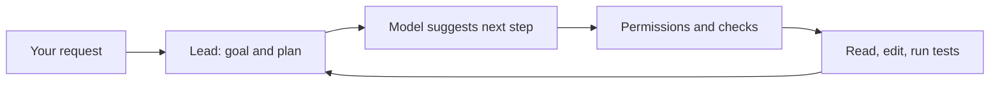
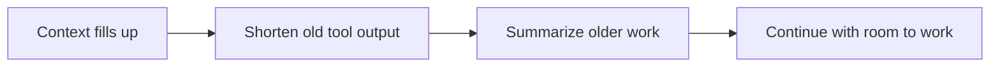

<div align="center">

```
   ⋆        ·      ✦                 ·    ⋆               ✧        ·
          ▀▀▀▀▀▀▀▀▀▀▀   ▀▀▀      ▀▀▀   ▀▀▀▀▀▀▀▀▀▀▀  ▀▀▀▀▀▀▀▀▀▀▀▀  ▀▀▀      ▀▀▀
         ▀▀▀▀▀▀▀▀▀▀▀▀  ▀▀▀      ▀▀▀  ▀▀▀▀▀▀▀▀▀▀▀▀  ▀▀▀▀▀▀▀▀▀▀▀▀   ▀▀▀    ▀▀▀
        ▀▀▀      ▀▀▀  ▀▀▀      ▀▀▀  ▀▀▀               ▀▀▀▀        ▀▀▀  ▀▀▀
       ▀▀▀      ▀▀▀  ▀▀▀      ▀▀▀  ▀▀▀▀▀▀▀▀▀▀▀       ▀▀▀▀         ▀▀▀▀▀▀
      ▀▀▀▀▀▀▀▀▀▀▀   ▀▀▀      ▀▀▀   ▀▀▀▀▀▀▀▀▀▀▀      ▀▀▀▀          ▀▀▀▀
     ▀▀▀▀▀▀▀▀▀▀    ▀▀▀      ▀▀▀           ▀▀▀      ▀▀▀▀          ▀▀▀▀
    ▀▀▀    ▀▀▀    ▀▀▀      ▀▀▀           ▀▀▀      ▀▀▀▀          ▀▀▀▀
   ▀▀▀     ▀▀▀   ▀▀▀▀▀▀▀▀▀▀▀▀  ▀▀▀▀▀▀▀▀▀▀▀▀      ▀▀▀▀          ▀▀▀▀
  ▀▀▀      ▀▀▀   ▀▀▀▀▀▀▀▀▀▀   ▀▀▀▀▀▀▀▀▀▀▀       ▀▀▀▀          ▀▀▀▀
     ·         ✦ ⋆        ·  ✦        ⋆ ·              ⋆          ✧
```

**A coding agent for your terminal. Written in Rust.**

*Inspect the code. Make the change. Run the check.*


<sub>A fresh terminal capture from the current CLI: inspect the failing discount tests, edit the source, and run the tests. Playback is 1.5×; idle gaps are capped at 1.5 seconds.</sub>

</div>

---

## How it works

One lead owns your task. It asks the model for a next step, checks proposed
tool calls, runs allowed work, and feeds the results back into the loop.



Jump to [everyday feature explanations](#everyday-features-explained),
[quickstart](#quickstart), [demos](#see-the-modes-in-action), or
[the command reference](#commands).

**[Read the simple architecture guide](docs/HOW_IT_WORKS.md)** for diagrams
and plain explanations of `/goal`, memory, compaction, subagents, swarms,
execution modes, permissions, side discussions, sessions, tools, and budgets.

## See the modes in action

Rusty runs in your terminal, with local tools, streamed answers, saved sessions,
and checks you can inspect. Choose how it works with `/mode`, how much it shows
with `/view`, and what it may do with `/permissions`. These are separate settings.

The recordings below use the real CLI and a live NVIDIA Nemotron provider.
Each execution demo starts with a fresh copy of [`demo/shop`](demo/shop), including
the same failing discount tests. They show observed runs, not a speed or model
quality comparison. [Capture details and reproduction commands](docs/demo/README.md).

### Standard: follow the failure through to a passing check

`/mode standard` → reproduce the failure → inspect the discount code → edit → test.
The recording at the top of this page shows the full journey.

### Careful: a separate checker reviews the finished change


The same bug fix with `/mode careful`. Watch the tool output and the separate
read-only checker before the final answer. A checker report and a passing local
test are evidence about this fixture; they do not establish production safety.

### Vibe: a small iteration, with a real check


`/mode vibe` takes a quick pass at the same task. It still runs a relevant check.
Execution modes do not change permissions or grant access to additional tools.

### Auto: let the request choose the execution profile


`/mode auto` handles a discount fix, a quick formatting prototype, and a read-only
production-risk review. The terminal states the selected profile and why it was
chosen. Everything runs against the local fixture.

### Default, verbose, ADHD: choose how much work you see


`/view default` groups exploration and keeps edits and commands visible.
`/view verbose` expands tool results and reasoning. `/view adhd` keeps a short
status line and concise answers. Each view performs a real source read and test run.

### Read-only, ask, auto, yolo: inspect permission decisions


This clip uses `/permissions check` to show the classifier's decisions for test
commands and pushes in each mode. These are classification previews: the push
commands are never executed. A force push still requires explicit confirmation
in yolo. Execution profiles and permissions are independent.

### A verified goal: the acceptance command decides whether it closes


`--goal` keeps the repair moving, and `--verify 'python3 -m unittest -q'` pins
the acceptance command before the run. Watch the verification result and the
final goal status. This establishes that the selected local check passed.

### A swarm: parallel findings, one lead making changes


`/agents swarm` lets the lead delegate module audits to read-only workers. The
terminal shows the worker activity and the lead's consolidated report.

### Sub, auto, off: control delegation explicitly


`/agents sub` enables a read-only helper. `/agents auto` lets the lead choose
whether to delegate. `/agents off` keeps the work with the lead. The recording
shows each setting handling a source inspection; the separate swarm clip shows
parallel module audits.

## Everyday features, explained

### Auto-compaction: make room before the conversation fills up

**This happens automatically.** The model can only read a limited amount in
one request: its context window. As that space fills, Rusty first shortens
older tool output, then summarizes older conversation so work can continue.
You see a notice when it compacts.



The goal and plan stay outside ordinary history. Your messages, each with the
reply that ended its turn, and useful working-set details are carried forward
within their budgets. A summary can lose detail, so name anything especially
important when you compact manually:

```text
/compact keep the rounding rules and the failing test cases
/context
```

`/context` shows where the space is going. You can also choose when automatic
compaction happens:

| Setting | Shorten old tool output after | Summarize older work after |
|---|---|---|
| `aggressive` | 40% | 60% |
| `standard` | 60% | 80% |
| `passive` | 75% | 95% |
| `smart` | 60% | 80%, or a suitable work boundary chosen by the model |

These percentages refer to usable context; a history cap can trigger it
earlier. If you have not chosen a setting, windows below 48k tokens use
aggressive, and larger ones use standard. Smart mode keeps the normal
thresholds as a backstop and can refuse a badly timed compaction.

```text
/compact settings smart
```

`--history-cap-tokens` sets an earlier history ceiling. `--compaction-model`
can use a different model for summaries, with the session model as fallback.
[Context details](docs/DESIGN.md#token-allocation).

### Memory: useful notes for the next task

Memory saves small lessons such as “prices are in cents” or “run this test
before editing the parser.” The local memory helper chooses relevant notes
for later requests using their relevance, track record, and file freshness.
Preferences are included separately when memory is enabled.

```text
/remember gotcha: prices are in cents; use integer arithmetic
/memory list
/memory search prices
/forget <id>
```

| Startup setting | What it adds |
|---|---|
| `--memory off` | Work without memory; useful for isolated benchmarks. |
| `--memory recall` | Retrieve relevant saved notes. |
| `--memory learn` | Also observe recent tool activity and update eligible notes from a goal's fixed check. This is the default. |
| `--memory reflect` | Also use a budgeted reflection after checked goals; successful checks can produce short new notes. |
| `--memory deep` | Allow more advice and more aggressive reflection and retirement. |

The helper, `rusty-memoryd`, starts on demand and stores notes locally. It does
matching and bookkeeping; reflection uses the lead's model client and budget.
Notes can be merged, lose trust, or be retired. `/memory helpful <id>` and
`/memory harmful <id>` let you give feedback. [Memory details](docs/MEMORY.md).

### Context, sessions, and memory each keep something different

| Thing | Easy way to think about it | Command |
|---|---|---|
| Context | Papers currently on the model's desk. | `/context`, `/compact` |
| Session | The saved folder for this particular job. | `/resume`, `rusty -c` |
| Memory | A notebook of lessons for future jobs. | `/remember`, `/memory` |

`rusty -c` resumes the latest session here. `/resume <words>` searches saved
work. `/clear` starts a fresh conversation while keeping long-term memory.

### Goals and plans: keep a finish line in view

`/goal fix the discount tests` keeps an objective open across turns. A plan
breaks it into smaller steps; `/plan` shows that checklist. The lead performs
the work through tools and proposes completion with evidence. In careful
mode, a plan step also says which check it will run and what result to expect
before running it; while the step is in the plan, the goal needs a passing
result for it to close, and the closed goal lists each expectation beside what
was observed. Rewording or dropping such a step is allowed but counted and
named, not refused.

To have the runtime decide completion using a check you chose beforehand:

```sh
rusty --goal "fix the discount tests" --verify "python3 -m unittest -q"
```

The fixed check runs after remaining work and any required careful review.
Failure or an unconfirmed result keeps the goal open. `/goal status` shows
progress, `/goal resume` continues, and `/goal clear` drops the objective.
Resuming a goal that is already done shows its evidence and does no work;
`/goal reopen` picks it back up.
Each explicit goal run or resume gets up to `RUSTY_GOAL_MAX_TURNS` turns
(default 25); zero pauses before work. Status shows this run and lifetime
counts and the saved stop reason. Interrupted or failed attempts count as
started turns; resource budgets and fixed acceptance are retained on resume.
A goal without `--verify` has no pinned acceptance command.
[Verification details](docs/VERIFICATION.md).

### Modes, permissions, workers, and views are separate knobs

| Knob | What it controls | Choices |
|---|---|---|
| `/mode` | How much thinking and checking to ask for. | `auto`, `careful`, `standard`, `vibe` |
| `/permissions` | What may run without asking you. | `read-only`, `ask`, `auto`, `yolo` |
| `/agents` | Whether optional research helpers are available. | `off`, `sub`, `swarm`, `auto`, `default` |
| `/view` | How much work appears on screen. | `default`, `verbose`, `adhd` |

Careful adds one read-only completion checker for changed work; the lead makes
any fixes. Vibe favors small iterations and can use a small worker pool. Auto
chooses a profile and explains why. These choices do not grant permissions.
The careful checker still applies when optional delegation is off.

Default view groups exploration; verbose expands calls and results; ADHD
keeps a short display and concise answers. [Execution details](#execution-modes)
· [Permission details](#permissions).

### Subagents and swarms: extra readers, one lead editor

A subagent takes one focused question, reads in its own context, and returns
a report. A swarm runs several jobs through a pool. Workers can share short
findings while they work. They are read-only; the lead assesses their reports,
makes the changes, and verifies the result. A brief can name a scope and the
answer that ends the job. Reports open with `path:start-end` references, and
the lead is told which of them name a missing file or lines past its end.

```text
/agents sub
/agents swarm
/swarm size 2
```

These settings make delegation available; the lead still chooses when to use
it. `/agents auto` lets it choose the arrangement. `/agents off` disables
optional helpers. `/agents default` follows the execution profile: vibe uses
small automatic delegation, while other profiles default to off.

`/swarm size` sets how many workers run at once, up to 16 locally; a call can
contain up to 32 tasks. `/agents model` chooses a worker model. `/swarm models`
and `/swarm spread` tune model rotation and temperature spread. Extra workers
use extra model requests from the shared budget.

### `/btw` and `/side`: follow a tangent without losing the main task

`/btw why did that test fail?` answers from a snapshot of existing context,
without tools or inserting the exchange into the main conversation.

`/side new rounding` opens a persistent read-only discussion with its own
history. `/side list` finds discussions; `/side open <id or name>` reopens one.
Use `/send main` to explicitly queue a summary of side findings, and `/back`
to return to the main task. The main chat checks observed file versions when
accepting a summary, so stale observations can be flagged.

### `/loop`: repeat a check while Rusty is running

```text
/loop 5m x3 check the test results and report changes
```

This repeats the prompt every five minutes, up to three runs. Without a fixed
interval, Rusty can choose its next delay. A loop is useful for repeated
checks; a goal works toward a finish line. The loop stops with the process.

### Tools, skills, and MCP: find things, do work, reuse a routine

| Feature | What happens |
|---|---|
| `search`, `glob`, `outline` | Find a file or definition before reading lots of code. |
| `read_file` | Read the relevant part of a file. |
| `write_file`, `edit_file` | Create a file or replace an exact, unambiguous string. Supported syntax checks can refuse a broken edit. |
| `bash` | Run a command under the permission policy, with bounded output and a timeout. |
| Owned running commands | Track a live command, inspect its status, and cancel it. A saved transcript cannot recreate its live handle. |
| `/review`, `/debug`, `/test`, `/feature` | Load reusable instructions that guide the lead's normal work loop. `/skills` lists built-ins and your own routines. |
| MCP servers | Discover additional tools from configured stdio servers and apply permission checks when calling them. |

Put MCP servers in `.mcp.json`, or set `RUSTY_MCP_CONFIG` to a configuration file.
`rusty --mcp-check` reports what connected and why anything is missing. Required
servers or tools can stop startup if unavailable; unsupported URL transports
are reported. [Tool architecture](docs/HOW_IT_WORKS.md#tools-the-hands-rusty-uses).

### Hooks: run your own checks around tool calls

A hook is a shell command of yours that runs before or after a tool call:
a script that refuses edits to generated files, say, or a formatter after
every write. Put them in `~/.config/rusty/hooks.json`:

```json
{
  "PreToolUse":  [{"matcher": "edit_file|write_file", "command": "~/bin/check.sh", "timeout_secs": 30}],
  "PostToolUse": [{"matcher": "edit_file|write_file", "command": "cargo fmt -q"}]
}
```

`matcher` lists tool names separated by `|` (MCP tools by their full
`mcp__server__tool` name); leave it out, or use `*`, to match every tool.
The command runs through `bash -c`, the same shell as the `bash` tool, in the
working directory with JSON on its stdin: `event`, `tool`, `args`, `cwd`,
`session_id` when the session is saved, and after the call `result` and `ok`. It gets 60 seconds unless `timeout_secs` says
otherwise (at most 600). What the exit code means:

| Exit code | PreToolUse (before the call) | PostToolUse (after the call) |
|---|---|---|
| 0 | The call goes ahead. | Nothing more happens. |
| 2 | The call is blocked. The model gets the hook's stderr as the reason and can try something else. | The hook's stderr is added to the result as a note for the model. |
| anything else, or a timeout | The call goes ahead and you see a warning. | You see a warning. |

PreToolUse hooks run before any permission prompt, so a call a hook blocks
never asks you. Hooks run for every call, including workers' and side
chats'. Notes for the model are redacted like any other tool output.
A PostToolUse hook that rewrites files the agent has read, like a formatter,
doesn't make its next edit there fail as changed on disk. It does mean the
agent reads such a file whole again before overwriting it, since it never saw
what the hook wrote.
Hooks run on your machine, so they only apply when the tools do: with
remote tools (Daytona or SSH) they are off, and rusty says so at startup.
Hooks are only read from `$HOME/.config/rusty/hooks.json`, never from the
project, and `RUSTY_HOME` doesn't move them: a project's `.env` can set
`RUSTY_HOME`, so honouring it would let a cloned repository run commands on
your machine just by being opened.
A `hooks.json` that doesn't parse gets one warning at startup and runs no hooks.

### Local or cloud tools: choose where commands land

Local tools run on your machine. Hybrid Daytona keeps the lead and memory
local while file and shell tools run in a configured sandbox. A full cloud run
moves the coordinator there too; model requests still use the provider.

`/tools local` or `/tools daytona` saves the default for the next session;
it does not move active work. A remote setup requires its bridge and an
existing environment. [Cloud setup](docs/CLOUD.md).

For infrastructure, `/target` shows the target account, context, workspace, and
branch. Careful mode applies relevant plan/diff and rollout checks. `/audit`
shows attempted infrastructure actions; `/changes` shows changed resources.
[Infrastructure details](docs/INFRA.md).

### Models, usage, and limits: see and bound the work

`/model` switches models while keeping the conversation in view. `/models`
lists available choices. `/doctor` checks configured providers and routing,
showing key names rather than values.

`/tokens` shows usage. `--stats` prints totals and `--trajectory` saves a record
of work. Request, token, and time limits are opt-in and shared across model
calls, including workers and reviews:

```sh
rusty --max-requests 20 --max-budget-tokens 100000 --budget-secs 300 \
  "explain the failing tests"
```

These are model admission limits, not a dollar billing cap. Near a bounded
run's end, the lead is told what remains and asked to finish rather than explore.
`/tips off` hides usage tips; `/tips on` restores them.

### Interrupts, repetition guards, and secrets: small protections during work

Ctrl-C interrupts a turn and cancels owned work. Inspect partial effects before
retrying. You can type a follow-up while Rusty works; it runs next. Press
Ctrl-C twice to quit.

Four consecutive identical calls returning unchanged results stop a turn.
A changed result or different call resets that counter. This catches a
particular repeated-call loop; it does not detect every kind of stalled work.

Recognized secrets in tool output are redacted before the model, screen, and
saved transcript see them. For local tools, handles such as `${RUSTY_SECRET_1}`
let an approved shell command reuse the value. Detection covers known patterns,
so avoid intentionally printing credentials.

### Menus and appearance: find the command without memorizing it

Type `/` to open the command menu. Keep typing to narrow it, use arrows to
choose, Tab to complete, and Enter to run or fill in an argument. Unknown
commands get a suggestion. Destructive session commands require an unambiguous
spelling.

`/theme` changes colors and `/font` changes the banner lettering. `/settings`
shows saved choices; command-line options can override relevant choices for a
run. `/help` lists commands. The [command reference](#commands) below keeps the
exact syntax in one place.

## Quickstart

```bash
git clone https://github.com/jadenfix/rusty && cd rusty
cp .env.example .env        # add NVIDIA_API_KEY, ANTHROPIC_API_KEY or OPENAI_API_KEY (or skip it after `codex login`)
cargo install --path .
```

```bash
rusty                                         # interactive
rusty "why does the build fail?"              # one shot
rusty --goal "get cargo test green" --verify "cargo test" --yolo
rusty -c                                      # resume the last session here
rusty -c 3f9a12c0                             # resume one by id (a prefix is enough)
rusty --sessions [words]                      # list the sessions saved here, or search them
rusty --doctor                                # which providers are set up and answering
rusty --capabilities                          # accepted values as JSON, for harnesses
rusty --toolset shell "fix the build"         # offer only bash, for interface experiments
```

Interactive resume (`rusty -c` or `/resume <id>`) shows recent requests and replies above the input. The preview is bounded to the terminal size; saved context is retained, with no model request or command replay.

While a turn or side session runs, type the next message in the bottom draft row. Enter queues it; Backspace edits and Ctrl-U clears the draft. Unsent text returns to the normal editor when work finishes. After Ctrl-C, queued text is held for review instead of being sent immediately.


Keys come from your shell, then `~/.config/rusty/.env`, then the `.env` next
to rusty's `Cargo.toml`. Set any of `NVIDIA_API_KEY`, `ANTHROPIC_API_KEY` and
`OPENAI_API_KEY`; with several keys for one provider (`ANTHROPIC_API_KEY_2`,
…), rusty rotates through them and backs off politely when rate limited:
it keeps retrying rate limits and server errors for up to five minutes
(`RUSTY_RETRY_SECS`), with jitter so parallel agents don't retry in step, and
gives up quickly on a key that is refused. While it waits, the panel says so
(`retrying in 8s · HTTP 429 …`). A reply that goes quiet for five minutes
(`RUSTY_STREAM_IDLE_SECS`) is dropped and asked for again, as long as no
answer text has been shown yet.

## Commands

`--goal ... --verify 'command'` pins a local acceptance command chosen by you.
Rusty runs it after the completion proposal's remaining tools and any careful
review. A failure, timeout, interruption, denied permission, or source-input
change keeps the goal open. Use `--verify-timeout 120` to set its deadline
(1–600 seconds). An unfinished verified goal exits with code 2; Ctrl-C remains
130. Goals without `--verify` retain their existing completion policy.

The command still obeys permissions. It establishes that the chosen check ran
successfully, not that it covers every requirement. For criterion integrity,
use inline assertions or a checker outside the editable workspace. Records in
sessions and `--trajectory` include observed status and workspace hashes;
resuming reruns verification rather than trusting saved receipts. See
[docs/VERIFICATION.md](docs/VERIFICATION.md) for input exclusions, scope, and
the staged repair/search roadmap.

Type `/` and a menu of commands opens under the prompt, narrowing as you type
(`/cmpct` still finds `/compact`). ↑↓ choose, Tab or → completes, and Enter
runs the highlighted command, or fills it in when it needs an argument. After a
command and a space the menu offers its values, such as `/mode ` → `careful`.
Piped input runs a partial command only when one command matches, and an
unknown one gets a "did you mean".

| | |
|---|---|
| `/goal <objective>` | autonomous until done and verified · `status` · `resume` · `clear` |
| `/loop [5m] [x10] <prompt>` | repeat on an interval, or self-paced |
| `/agents off\|sub\|swarm\|auto` | delegation · `/agents model <id>` sets the subagent model |
| `/swarm size\|models\|spread` | workers at once (up to 16; a swarm call takes up to 32 tasks and workers share findings), model rotation, temperature spread |
| `/compact [focus]` | summarise now, keeping what you name in detail |
| `/resume [id|words]` | list saved sessions, search them, or pick one up |
| `/compact settings [mode]` | when to compact: `aggressive` (summarise at 60% of the usable window), `standard` (80%, the default), `passive` (95%) or `smart` (the model compacts when a sub-task is done; rusty refuses at a bad moment and keeps its last two steps verbatim) |
| `/target` · `/audit [n]` · `/changes` | where infra commands will land · the infra audit log · what this session changed |
| `/triage` `/change` `/postmortem` | infra skills: incident triage, a change plan with rollback, a blameless write-up |
| `/context` · `/tokens` | where the window is going · spend by model and by tool |
| `/memory` · `/remember` · `/forget` | long-term memory |
| `/permissions [mode]` | `read-only` `ask` `auto` `yolo` · `allow` · `deny` · `check <cmd>` |
| `/mode auto\|careful\|standard\|vibe` | how hard rusty thinks and checks its work |
| `/tools [local\|daytona]` | show tool placement; save the default for the next session |
| `/view default\|verbose\|adhd` | how much you see |
| `/theme` · `/font` | `rust` `neon` `matrix` `amber` `ice` `mono` · `rust` `block` `thin` `classic` |
| `/review` `/explore` `/feature` `/debug` `/test` `/commit` | built-in skills · `/skills` lists yours too |
| `/doctor` | each provider's keys (names only), endpoint, model count and latency, and where the current model goes |
| `/model` · `/models` · `/plan` · `/tips` · `/settings` · `/clear` · `/exit` | |

rusty reads the context window from the endpoint's model list. When the
endpoint doesn't publish one, pass `--context-tokens`, or rusty assumes 128k
and says so. `--history-cap-tokens` makes compaction start by that many tokens
however large the window; above a 200k window the cap is 128k unless you set
one. `--compaction` sets the mode for one run, and `--compaction-model` hands
summaries to another model, with the session's model as the fallback.
`--stats` and `--trajectory` record each compaction: why it ran, the tokens
before and after, and where the work resumed.

## Execution modes

How hard should rusty think, and how many times should it check its work?
That's separate from what it's allowed to do.

| | |
|---|---|
| `auto` | The default. rusty picks one of the three below for each request and says why on the first line: careful when it mentions production, a migration, a deploy, data, money, security, infrastructure or an incident; vibe for a quick prototype or sketch; standard otherwise, including whenever it's unsure. During a turn it only ever moves up to careful, when a consequential command comes up or three commands fail in a row. It never changes permissions. A configured per-mode model can follow the profile unless you explicitly chose a model. |
| `careful` | Thinks longer. When it says it's done, a separate read-only checker looks at the real files and your instructions and reports what's wrong. rusty fixes that and verifies it, with no second review. A plain question isn't checked, and a goal gets one checker attempt, including after saving and resuming. |
| `standard` | Normal effort, and it checks what it changed. |
| `vibe` | Quick passes and small checks. It can send out up to three read-only workers to look things up in parallel. It still has to run a relevant check before it calls something done. |

```bash
rusty --mode careful --goal "move the sessions table to the new schema without losing rows"
rusty --mode vibe "sketch a settings page"
```

Switch with `/mode auto|careful|standard|vibe`; the choice is saved, and an
explicit mode always beats auto. `--mode` or `RUSTY_MODE` sets it for one
run. To use a different model per mode, set
`RUSTY_CAREFUL_MODEL`, `RUSTY_STANDARD_MODEL` or `RUSTY_VIBE_MODEL`
(`--model` and `/model` still win). If you choose `/agents` settings
yourself, they stick; `/agents default` hands delegation back to the mode.

On the default NVIDIA model, careful and vibe also set the model's
reasoning budget. In a quick test, the low budget clearly cut reasoning,
but asking for "high" made no difference on easy questions. Whether careful
mode beats standard on real tasks is still being measured; see the evals
below.

All profiles stop a turn after four consecutive identical tool calls return
unchanged results. Remaining tools in that batch are skipped and the goal stays
open. A different call or changed output resets the counter; JSON formatting
changes do not. This bounds exact-call loops, not every possible lack of progress.
It adds no model request, checker or dependency.

## Permissions

Built for letting an agent run on its own, with a hard stop for anything
you can't take back.

```
                 reads, searches,   project edits,     pushes to main,    force push, cloud or
                 cloud reads        builds, installs,  deploys, PRs,      database deletes,
                                    feature pushes     anything unclear   rm -rf outside, disks
read-only            run               refused            refused            refused
ask                  run               asks               asks               needs you, every time
auto                 run               run                asks               needs you, every time  ← default
yolo                 run               run                run                needs you, every time
```

- **Runs on its own in auto:**
  - building, testing, linting and installing project dependencies;
  - deleting build folders (`rm -rf node_modules dist target`);
  - everyday git (commit, branch, rebase, pull, push a feature branch);
  - calls to your local dev server, and plain downloads;
  - read-only cloud commands: `aws … describe/list/get`, `kubectl get/logs/describe`, `terraform plan`, `gcloud … list`, `gh pr view`, `docker ps`, `SELECT` queries.
- **Asks first:**
  - pushing to `main` or another shared branch;
  - `git reset --hard` and anything else that throws away uncommitted work;
  - deploys, `terraform apply`, `kubectl apply`;
  - opening or merging pull requests;
  - writes outside the project;
  - reading `~/.aws/credentials` and other keys;
  - sending local data off the machine;
  - commands rusty doesn't recognise.
- **Needs a typed `yes` every time, even in yolo:**
  - force pushes and deleting remote branches or history;
  - `terraform destroy`;
  - cloud deletes (`aws s3 rm`, `kubectl delete`, `gcloud … delete`, `fly apps destroy`);
  - `DROP`, `TRUNCATE`, and `DELETE` without `WHERE`;
  - `prisma migrate reset`;
  - `rm -rf` outside the project;
  - disk writes.

  An allow rule can't skip this. With nobody at the keyboard (a script, CI, a benchmark), it's refused, and the model is told to hand the command to a person.
  The one exception is a disposable sandbox that a harness runs on purpose: `RUSTY_ALLOW_DESTRUCTIVE=1` together with `--yolo` and no terminal lets these run, each with a warning line. It has no effect in an interactive session or any other permission mode.

rusty looks at what a command will really run, not just its first word:
- the scripts it calls, `package.json` scripts, `make` targets;
- heredocs piped into a shell, and `$(…)` substitutions;
- commands sent through `ssh`, `docker exec` and `kubectl exec`;
- code passed to `python -c`.

So `npm run deploy` is judged by what `deploy` does.

`/permissions check <command>` shows the verdict and why. Deny rules always
win. At a prompt, `a` allows that kind of call from then on, and typing
anything else sends it back to the model as feedback.

## Verified end to end

The live rows use the real model and a real terminal, and every eval check
is hidden from the agent. The offline tests drive the real binary against a
scripted stand-in for the model, so they're free and repeatable.

| What | Result |
|---|---|
| `cargo xtask qa`: fmt, clippy `-D warnings`, offline Rust tests (including the real binary and memory service), 6 memory smoke cases, 7 cloud launcher tests | pass |
| Live end-to-end against the model: bug fix, goal mode, swarm, Ctrl-C exit code | 4/4 |
| Real pseudo-terminal: Ctrl-C during a streaming turn | stops in ~10-70 ms, next turn works, double Ctrl-C quits |
| 12 evals in each mode: Python, Rust and JS fixes, code search, a cross-file rename, a CLI flag, a change of plan midway, memory across sessions, a rule surviving compaction, undo one step, a long `/goal`, `/compact` with a focus | careful 12/12 · standard 11/12 · vibe 11/12 · auto 10/12 |
| Inside a FullStack-Bench task container under Harbor | installs, works the task with the environment's own CLI, closes its goal with evidence |

These are single runs of each task on the same model, so a difference of
one or two tasks between modes isn't meaningful yet. Runs that the API's
rate limit cut off were rerun, and every miss was read from its logs:
- standard and auto each went in circles on one task until the time limit;
- vibe closed one goal that failed the hidden checks;
- auto ran out of time on another goal even after switching itself up to careful.

Careful used about 2.5 times the tokens of standard on the tasks both passed.

Five newer tasks (a Rust ring buffer, exact-cents bill splitting, backup
rotation in bash, a bounded-concurrency `fetchAll` in JS, and a TTL cache
written from its docstring) check more than their visible tests do, so
fixing only the example doesn't pass. The `evals` workflow runs any of this
on demand from GitHub with the repository's keys.

```bash
cargo xtask qa           # offline checks
cargo xtask qa --live    # plus live tests, the terminal check and every eval
cargo xtask memory-smoke --live --binary target/release/rusty   # the memory cases at every level on NVIDIA
cargo xtask memory-bench # memory advice latency with 512 stored lessons (release build)
cargo xtask eval multi   # just the multi-turn evals; logs land in target/evals/

# the same tasks on several models, three runs each, compared in one table
EVAL_MODELS="claude-opus-5-5 gpt-5 nvidia/nemotron-3-super-120b-a12b" EVAL_REPEATS=3 cargo xtask eval
# the same, comparing memory levels side by side
EVAL_MEMORY="off learn reflect" EVAL_REPEATS=3 cargo xtask eval multi
cargo xtask eval-report target/evals/*.jsonl   # pool earlier runs into one table
```

## Models

Anything your endpoint serves, chosen with `--model`, `RUSTY_MODEL` or `/model`.

| Model on NVIDIA's API | |
|---|---|
| `nvidia/nemotron-3-super-120b-a12b` | **default**, fast and dependable with tools (used in the live recordings above) |
| `nvidia/nemotron-3-ultra-550b-a55b` | bigger, slower, thinks harder |
| `z-ai/glm-5.3` | strong coder, slow to first token |
| `openai/gpt-oss-20b` | small and quick; a good swarm worker |

| Anthropic and OpenAI | |
|---|---|
| `claude-opus-5-5` | the default when `ANTHROPIC_API_KEY` is the only key; adaptive thinking, effort follows the execution mode |
| `claude-sonnet-5-5`, `claude-haiku-4-5` | faster and cheaper; Haiku makes a quick swarm worker |
| `gpt-5` | the default when `OPENAI_API_KEY` is the only key; reasoning effort follows the execution mode |

| Codex sign-in | |
|---|---|
| the model from `~/.codex/config.toml` | the default when `codex login` is the only setup; `gpt-*` ids go here when there is no `OPENAI_API_KEY` |

rusty picks the provider from the model id, per request, so one session can
mix them: `/model claude-opus-5-5` for the lead and
`/agents model openai/gpt-oss-20b` for the workers. Bare `claude-*` ids go to
Anthropic's Messages API, bare `gpt-*` and `o4`-style ids to OpenAI, and
anything else (including `openai/...` ids on NVIDIA) to the compatible
endpoint. `RUSTY_PROVIDER=anthropic|openai|compatible|codex` overrides the guess.

**Direct shell:** type `!pwd`, `!git status`, or `! command` at the prompt.
The input switches to an amber shell label. Rusty runs it without a model
request, shows stdout/stderr and the exit code, and keeps the redacted result
in conversation context for your next question. Permissions and infrastructure
checks still apply; Ctrl-C stops the command. Commands use the current tool
location (local or Daytona), are non-interactive, and have a 120-second limit.
Each command starts a fresh shell: use `!cd directory && command` when needed.
Use your ordinary terminal for interactive programs such as `ssh` or `vim`.

The provider line distinguishes saved credentials from a successful model
response. `unverified` means no response has completed in this process for that
model; `response OK` records a completed response, not an ongoing connectivity
promise. Failures and interrupted responses remain visible. `/doctor` can probe
provider model catalogs, but a cached Codex model list is never a live check.

**Codex settings:** `/codex models` lists cached model names; `/codex model` shows the shared default;
`/codex model <id>` updates the top-level model in `$CODEX_HOME/config.toml`
(or `~/.codex/config.toml`) and applies it to a currently Codex-routed session.
Profile models and unrelated settings stay intact; a private timestamped backup
is saved beside the file. `/model <id>` still changes only the current session.
`/codex config` opens the full config using `$VISUAL`, `$EDITOR`, or `vi`, so you
can edit reasoning effort, profiles and other Codex settings. Those other
settings are Codex settings, not Rusty runtime controls; Rusty uses its own
`/mode` controls. Restart Codex to pick up edited defaults.

On a light terminal background, select `/theme paper`; use `/theme rust` with
the dark cmux/Ghostty preset. The terminal background is independent of the skin.

**Signed in to Codex?** rusty can use that ChatGPT account instead of a key.
It reads the tokens `codex login` saved in `~/.codex/auth.json` (`CODEX_HOME`
to point elsewhere), talks to the Codex backend's Responses API, refreshes the
access token the way Codex does and writes the refreshed tokens back, so both
tools stay signed in. A `gpt-*` model goes there whenever `OPENAI_API_KEY` is
not set, and `/doctor` shows the sign-in as the account's email. Encrypted
reasoning items go back to the API between turns, like Claude's thinking
blocks. The backend publishes no model list, so `/models` shows only the
model Codex itself is set to; `/model` takes any id the backend serves.

On Claude, thinking blocks go back to the API unchanged between turns, and
since compaction rewrites history, rusty asks the API to drop a thinking
block whose conversation changed instead of failing the request. On the
models that support it, a request Claude's safety checks decline is retried
on Anthropic's recommended fallback model inside the same call.

To use another endpoint, set `RUSTY_BASE_URL`, for example `http://localhost:11434/v1`.
A `claude-*` or `gpt-*` model with no key of its own goes there too, so a local
router keeps working. `ANTHROPIC_BASE_URL` and `OPENAI_BASE_URL` point those
providers somewhere else.

## Run it anywhere

Keep reasoning and memory local while executing the entire swarm's tools in
Daytona. `rusty-cloud hybrid` talks to Daytona's REST API and attaches to an
already started sandbox; it never creates or wakes one. The snapshot must contain
this version of rusty and the remote workspace must already exist.

```bash
cargo build --bins
target/debug/rusty-cloud hybrid --sandbox <id> --workspace /home/daytona/work \
    --mode standard --agents swarm --swarm-max 3 --memory-mode learn \
    --prompt "Use three workers to inspect the project, then fix and verify the bug."
```

`--tools local|daytona` (or `RUSTY_TOOLS`) overrides the saved default.
`/tools` and `/settings` show the current location; `/tools local|daytona`
changes the next session, so a goal never changes workspaces halfway through.
The hybrid launcher supplies the ephemeral localhost tool bridge for
`--tools daytona`. Swarm workers remain read-only and share the lead's remote
checkout; only the lead edits. No model credentials are copied to the sandbox.
Cloud compute and model usage still consume credits. Full setup, lifecycle,
placement choices and evidence are in [docs/CLOUD.md](docs/CLOUD.md).

The core CLI is one static binary. `docker build --target bin -o out .` produces
`rusty` and the optional `rusty-memoryd` companion for Linux.
[docs/MEMORY.md](docs/MEMORY.md) covers the memory levels `--memory off|recall|learn|reflect|deep`, the
RAM-only L1, packed L2, learning from feedback, live checks and cloud transfer.
[docs/ARCHITECTURE_AUDIT.md](docs/ARCHITECTURE_AUDIT.md) records the storage,
dependency and privacy tradeoffs. Redistributed binaries include `LICENSE` and
`THIRD_PARTY_NOTICES.txt`.
[docs/CLOUD.md](docs/CLOUD.md) covers Daytona sandboxes
(`rusty-cloud run --repo … --goal …`), AWS, Devbox and Docker.
rusty also plugs into Harbor benchmarks with `--goal`, `--trajectory` and
`--stats`.

## Inside


<sub>Solid arrows execute; dashed ones only advise. Without <code>--verify</code>, a goal closes on the model's own evidence; see <a href="docs/VERIFICATION.md">docs/VERIFICATION.md</a>.</sub>

```
src/
  main.rs         CLI, REPL, slash commands, settings
  agent.rs        the loop: model ⇄ tools, goal, loop, subagents and swarms, compaction
  display.rs      grouped tool lines, status line, recaps, views
  llm.rs          streaming client on a background thread, tool-call assembly, key rotation
  tools.rs        read, write, edit, list, search, glob, outline, bash
  permissions.rs  the command classifier
  advisor.rs      memory levels and the advisor: lessons, confidence, file anchors, credit (rusty-memoryd)
  recall.rs       identifier-aware tokenizer and BM25 inverted index
  context.rs      budgets, elision, compaction, the working set
  skills.rs       built-in and user skills
  tips.rs         token tips from real usage
  markdown.rs     terminal markdown
  ui.rs           themes, banner, mission line
  footer.rs       steady status panel and falling geometric rail
  execution.rs    careful, standard and vibe profiles, and auto's pick
  infra.rs        live target, dry-run gate, snapshots, audit log, redaction
```

Why it's built this way: [docs/DESIGN.md](docs/DESIGN.md) covers where coding
agents hold up on long tasks, where they fall apart, and what rusty does about
each.

## Contributing

Conventional Commits, and pull requests written by a person, for people. See
[CONTRIBUTING.md](CONTRIBUTING.md).

## License

MIT

The status panel stays beneath the transcript on the normal terminal screen;
completed output enters ordinary scrollback. The three diamonds fall inside
the panel instead of moving the entire status line. Terminals narrower than
31 columns or shorter than eight rows use one compact line. `RUSTY_NO_ANIM=1`
keeps the rail still; `NO_COLOR=1` and pipes use plain output. No animation
thread or full-screen terminal framework is involved. Unicode cell measurement
uses the same `unicode-width` version already used by rustyline.

To capture and inspect the real CLI without model credentials:

```bash
cargo xtask tty-capture --binary target/debug/rusty --output /tmp/rusty-tty
cargo xtask tty-inspect /tmp/rusty-tty
```

The captures exercise real file writes, Bash results, streamed replies, and
interactive Ctrl-C recovery on a real pseudo-terminal at 24/40/80/120 columns,
against a local stand-in provider. The inspection replays each capture on a
small terminal screen model and checks every panel frame for complete borders,
an unused wrap column, colour, a footer that stays on the bottom row, and a
clean exit. `cargo xtask tty` runs the same checks as a quick pass/fail.

### A question on the side

`/btw <question>` answers from the current conversation with no tools. It can
run while a model response or shell command is in progress. The main task
continues; the aside is shown separately and never enters its transcript,
plan, goal, verification or learned memory. Recent aside exchanges provide
context for follow-up `/btw` questions. `/btw` alone shows the last answer.
Asides use the same model client and root budget, and their usage is included
in the session totals. They are temporary and disappear when the process exits.

### Persistent read-only discussions

`/side new <name>` starts a saved child conversation from the main context.
Ask it follow-up questions and let it inspect local files with read-only tools.
`/back` selects the main chat; `/side open <name or id>` returns to the child,
and `/side list` shows saved children. A side has its own history and no parent
goal or verification authority. Its findings stay out of the main conversation.

Side commands also work while the main turn is running. Questions entered
while a side is selected go to that side; `/back` changes focus without stopping
its work. Ctrl-C targets a running selected side; quitting cancels and saves
outstanding side turns. Settings commands require returning to main first.
The shared checkout is live, not frozen, and side tools are classifier-enforced
read-only, not an OS sandbox. Side tools are local-only for now, with no MCP
servers or nested delegation. All model calls share the parent's root budget.

### Returning findings to main

From a selected side, `/send main` prepares a bounded summary of that side's
own discussion and queues it for its recorded parent. It uses no tools and
shares the root budget. The parent receives the note between tool steps, or
on the next idle input cycle, with source/revision labels and warnings when
observed files changed. The note is generated advice, not a user instruction,
permission grant or passing verification receipt. An idle parent does not start
a new coding turn automatically; use `/back` and continue when ready.

The inbox survives restart. Delivery receipts are saved with the parent before
queued notes are removed, so replay does not duplicate a summary. Repeating
`/send main` without further side discussion does not spend another model call.
Sending findings does not apply a patch, merge a branch or close the main goal.

GitHub, GitLab and Bitbucket setup lives in `/integrations` (or keyless
`rusty --integrations`). `/git` provides native repository views. See
[repository integrations](docs/INTEGRATIONS.md) for authentication, enterprise
hosts, fork targeting and evidence boundaries.
