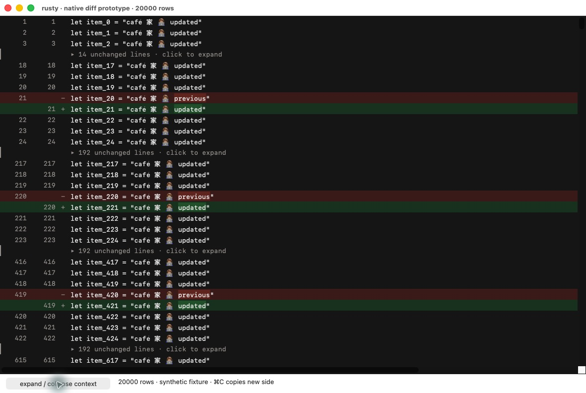
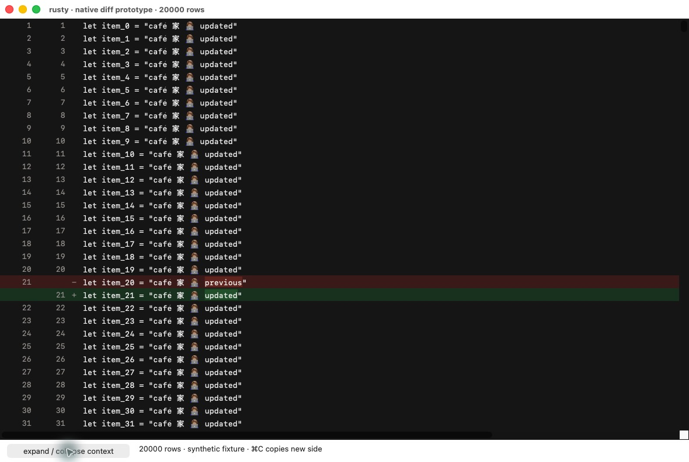

# Native diff row-view spike (stage 0)

This is an isolated, dependency-free SwiftPM experiment for the approved native
Mac app. It is not the app, a shipped inspector, or a replacement for the Rust
worker. Nothing here is imported by the Rust CLI or the separate RustyKit package.
Requires macOS 14 or newer and the Xcode Swift toolchain.

## Current running prototype

These app-only screenshots show the Release AppKit harness with 20,000 synthetic
rows, captured from its running window. They demonstrate folding and additions/
deletions, not a connected coding session or notification delivery.





Capture provenance is in [the screenshot manifest](../../../docs/screenshots/native-diff-capture.json).


```sh
swift test --package-path apps/macos/DiffPrototype --jobs 2 -c release
swift build --package-path apps/macos/DiffPrototype -c release --jobs 2
apps/macos/DiffPrototype/.build/release/diff-prototype --benchmark
apps/macos/DiffPrototype/.build/release/diff-prototype --render-check apps/macos/DiffPrototype/evidence/release-render
apps/macos/DiffPrototype/.build/release/diff-prototype
# Same interactive drawing surface with 100,000 synthetic rows:
apps/macos/DiffPrototype/.build/release/diff-prototype --100k
```

The final two commands activate a dedicated prototype window. Coordinate them
with any ongoing computer-use work first. Close it with Command-Q.

The one `NSView` draws only rows intersecting its dirty viewport. A CoreText line
cache uses a strict 2,000-entry FIFO ring (constant-time lookup and eviction). Source rows and a visible-row projection
are flat arrays; initial construction and collapse rebuild are O(N). The view
never creates an AppKit view for each source row. Expansion scans the rows once;
it does not repeatedly splice an array for each context group. Copy is O(selected
text size). The UTF-8-to-UTF-16 mapper scans requested offsets in scalar order with constant
auxiliary memory (it retains the source string), and is used only
when requested; protocol code must reject invalid UTF-8 before applying offsets.

The model preserves original row coordinates across folding. Drag to select,
Shift-click to extend, Command-A to select all, and Command-C to copy new-side
text (deleted rows omitted). The context menu also copies with +/- signs. This is not a git-apply-able patch. Selection
across collapsed context includes the hidden source text. Partial UTF-16
selections expand to composed character boundaries. Click a context marker to
expand it, or use the bottom button to expand/collapse all context. The synthetic
fixtures contain accented text, CJK, and an emoji ZWJ sequence, plus additions,
deletions, stronger intraline fills and non-color +/- signs.

`--benchmark` measures model construction, projection, expansion and copying.
`--render-check` paints native offscreen bitmaps of a 704pt viewport and checks
that at most 33 source/display rows were painted. Its PNGs are **offscreen test
renders**, not screenshots of a running app. It measures paint wall time only,
not scroll-event handling, compositor frames, display hitches or Instruments
scrolling metrics. Raw build/test logs and benchmark receipts are in `evidence/`.
A peak process RSS from `/usr/bin/time -l` includes the executable, frameworks,
fixtures and temporary allocations; it is not the incremental cost of an open
file. Keep this distinction when comparing with the audit's initial targets.

## Deliberate limits / remaining experiments

- Synthetic row data, not generated Rust diff hunks or a real repo integration.
- Unified rows only; no split alignment, syntax lexer, hunk headers, find bar,
  native source NSTextView, minimap or app shell.
- A temporary spike palette, not generated theme tokens. Only this palette is
  rendered; all-theme contrast/snapshot gates belong to stage 1.
- Extremely long lines are drawn through their first 4,096 graphemes and the
  document width is fixed at 1,600pt. Full text remains available to copy.
  Production needs explicit long-line paging/width policy and a truncation cue.
- Mouse selection and menu copy are implemented; keyboard selection navigation,
  NSTextFinder, selection auto-scroll edge cases, accessible collapse actions
  and VoiceOver traversal still need UI work and executed qualification. The
  prototype exposes only the visible rows as lazy accessibility text elements.
- No claim about live scroll hitches, window launch, memory deltas, production
  readiness or overall superiority is made by the offscreen/model receipts.

## Review corrections and metric provenance

The Opus stage-0 review passed the structural row-view experiment with
corrections C1–C3 required before stage 1. The initial nine tests were **debug**
XCTest, despite an agent update calling them release. The corrected run is
`evidence/swift-test-release.log`: ten model XCTest cases in Release, including
both fold-marker selection directions. It is a functional test run, not an
XCTest performance-metric run.

In benchmark JSON, `fixture_ms` is **synthetic fixture generation**
(`Fixtures.rows` string construction), `projection_ms` is `DiffDocument.init`,
`expand_ms` is `setCollapsed(false)`, and `new_side_copy_ms` is string creation
for the entire new-side selection. They are separate spans and must not be
combined or described as application launch time. The old GUI status `built N ms`
was removed because it mixed fixture synthesis, projection and AppKit init.

The app accepts `--expanded` and `--metrics-file /absolute/path.json`. An
`os_signpost` interval `DocumentReceiptToFirstPaint` starts after synthetic rows
are available and ends after the first real AppKit `draw(_:)` completes. It
excludes fixture generation, process launch and compositor presentation; it is
not proof of a frame appearing on screen. `DiffDraw` and `CTLineCreate` intervals
are also exposed under subsystem `dev.rusty.diff-prototype`, points-of-interest.
Use `--measure-memory` in a **separate run**, never while collecting scroll
metrics: it warms the actual native view's 2,000 CTLines and records Mach
`task_vm_info.phys_footprint` before fixture construction, after first paint,
and after cache warming. This includes model, view, first-use AppKit/font costs
and real CTLine cache; it is not peak RSS or the model-only delta.

The minimal `UIHarness/DiffPrototypeHarness.xcodeproj` is a measurement harness,
not the stage-1 app. Its Release UI tests request
`XCTOSSignpostMetric.scrollingAndDecelerationMetric`, ten iterations each for
20k collapsed, 20k expanded, and 100k expanded. The first attempt compiled but
never entered a test method before cancellation; its interrupted xcresult
contains zero passed tests and a runner-level cancellation failure. No scroll
hitch ratio is available from it. The concurrent 30-second Animation Hitches
attempt grew to 4.7 GiB while ending; it and its equally large raw temp were
removed to recover urgently needed disk space. The failed-attempt JSON/log are
preserved. No metric is claimed from that incomplete trace.

Current first-paint and memory observations were recorded while system load
was 41–69 on a 10-core Mac. The 20k real-view/cache memory delta was 29.08 MB,
below the initial 50 MB target in that run. Its document-receipt-to-first-draw
was 604.49 ms, **not** a passing 250 ms open-time result. A quiet documented
run, a valid xcresult with scroll metrics and a bounded Animation Hitches trace
remain required before C1 can close. No stage-1 gate is implied by building
this measurement harness.

Raw measurement logs, screenshots, traces and result bundles live in the ignored `evidence/` directory. They are local review artifacts; reproduce them with the commands above. An interrupted runner or trace is never a performance pass.

## Document-owner lifecycle checks

The standalone spike now gives its synthetic window to a small
`NSWindowController` owner. Closing the window detaches the document, controls,
selection callback and measurement objects, and removes the closed controller
from the application owner. The application can remain alive without retaining
that closed document. Command-Q still terminates the prototype. This introduces
no worker wrapper, session supervisor, background execution or stage-1 UI.

The default, offscreen SwiftPM lifecycle tests exercise the same owner used by the
executable, rather than duplicating its hierarchy. After three warmed cycles,
they perform twenty more construction/use/close cycles, hold AX children across
close, drain autorelease pools and the main run loop with a five-second hard
release deadline, and check weak owner/window/controls/view/status references.
Post-warm-up fd counts must return within two of baseline. A second test retains
the controller itself and checks that close still releases its document graph.
No subprocess or worker exists in this target, so these tests do not qualify
worker shutdown, socket cleanup or process reaping.

```sh
RUSTY_NATIVE_LIFECYCLE_RECEIPT=/absolute/path/lifecycle.json \
  swift test --package-path apps/macos/DiffPrototype --jobs 2 -c release \
  --filter DocumentLifetimeTests
```

The optional receipt and test log include per-cycle diagnostics. Physical
footprint observations are diagnostic only; they do not assert RSS stability,
a quiet-machine memory budget, or global leak freedom. Do not run this alongside
scrolling performance measurements. Source content is fixed for each prototype
view: its document setter is private, and document replacement/cache
invalidation remains outside this synthetic spike.


A separate presented/drawn lifecycle test is skipped by default. It brings up
23 native windows and requires an explicitly coordinated GUI window with no
other computer-use driver. Enable it only for that controlled run:

```sh
RUSTY_NATIVE_PRESENTED_LIFECYCLE=1 \
RUSTY_NATIVE_PRESENTED_LIFECYCLE_RECEIPT=/absolute/path/presented-lifecycle.json \
  swift test --package-path apps/macos/DiffPrototype --jobs 1 -c release \
  -debug-info-format none \
  --filter testPresentedDrawnDocumentsReleaseAfterProgrammaticWindowClose
```

Each cycle uses the actual `present()` path and waits, with a hard deadline, for
a visible registered window and a nonzero AppKit draw count before warming the
2,000-line cache. It checks owner/window/root/scroll/controls/diff/status weak
references are populated before closing through `performClose`, and all clear
after autorelease-pool/run-loop draining. Three warm-up cycles precede twenty
observed cycles and the fd comparison. AX elements returned by the view's
direct getter stay held across close; **this does not qualify an external AX
client, XCUI, or VoiceOver**. Those require separate tests on the same source.
A completed AppKit draw is not proof of compositor presentation, scroll hitches,
or RSS stability. The opt-in test's output must not be conflated with the
previous offscreen lifecycle receipts.
