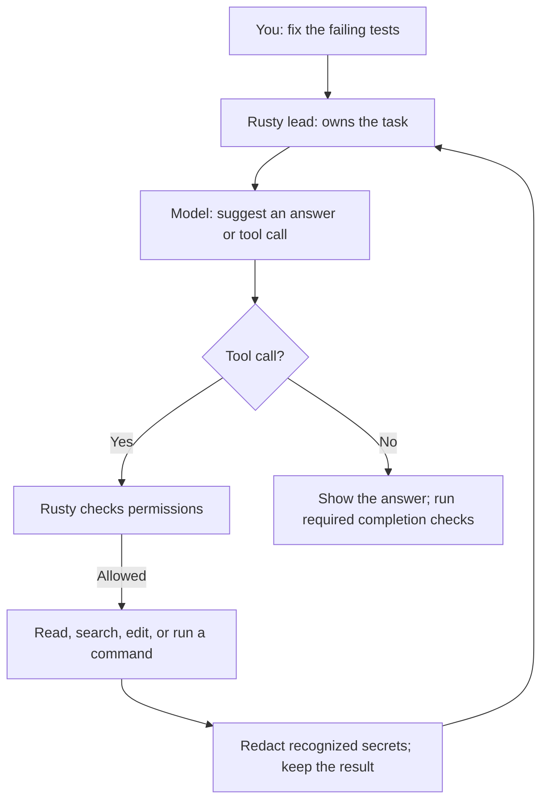
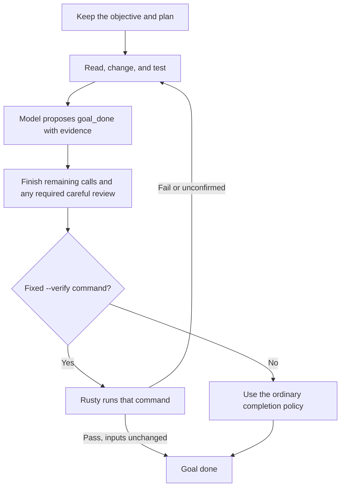
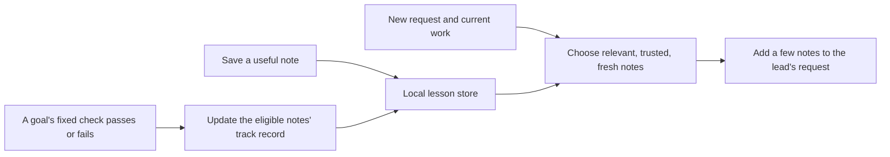
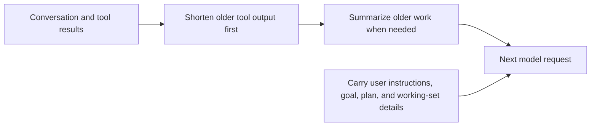
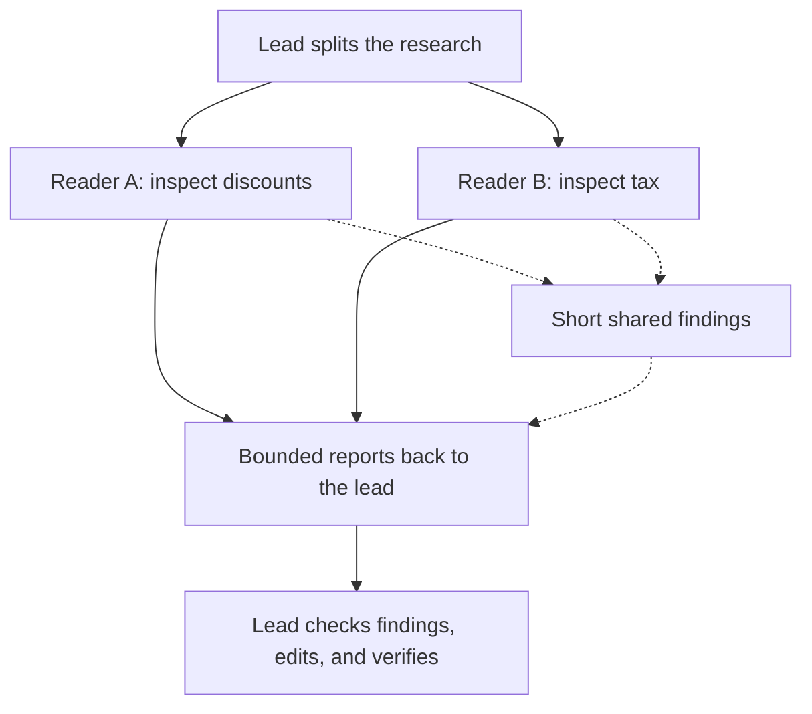
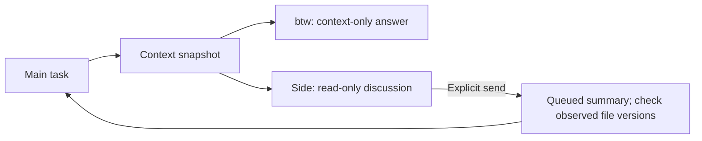
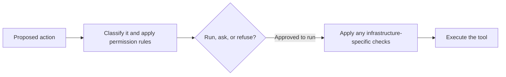

# How Rusty works

Rusty is a small program that runs a work loop: **ask the model, run an allowed
tool, read the result, repeat**. One lead owns the task. Saved notes, extra
readers, and checks help that lead do the work.

Start here if you want the plain-language version. For the actual screen,
see the [recorded demos](demo/README.md).

## The whole thing in one picture



The **model** suggests the next step. The **Rusty program** controls which tools
are available, checks permission, executes the call, and records what happened.
A turn may contain many tool calls before you get the final answer.

The model is reached through a configured provider endpoint. The Rust program
and its coordinator run on your machine by default. Cloud placement is
explained [below](#where-the-work-runs).

## Four settings you can change independently

Think of four knobs on the same machine:

| Setting | Simple question | Example |
|---|---|---|
| `/mode` | How much thinking and checking? | `careful` |
| `/permissions` | What may run without asking me? | `auto` |
| `/agents` | May the lead ask extra readers for help? | `swarm` |
| `/view` | How much work should appear on screen? | `adhd` |

For example, careful work can still have automatic permission for routine
project edits, optional delegation switched off, and a short display:

```text
/mode careful
/permissions auto
/agents off
/view adhd
```

Careful mode's own completion checker still applies. `/agents off` controls
optional task delegation; the careful checker belongs to the execution mode.

### Execution modes: how Rusty approaches the task

| Mode | Super simple explanation |
|---|---|
| `standard` | Take a focused pass, make the change, and check the result. |
| `careful` | Spend more effort on risks. After changed work is proposed as finished, ask a separate read-only checker to inspect it. The lead handles corrections. |
| `vibe` | Take small, quick iterations with focused checks. Unless you override delegation, it can use a small pool of up to three workers. |
| `auto` | Choose a profile from the request and target. Show the choice and reason. |

Auto generally chooses standard for ordinary work, vibe for a quick prototype,
and careful for consequential work such as production changes. A production
target makes it choose careful. During a turn it can move up to careful when
risk or repeated failures appear.

The profiles do not grant permissions. Model settings can also follow a
profile if you configured `RUSTY_CAREFUL_MODEL`, `RUSTY_STANDARD_MODEL`, or
`RUSTY_VIBE_MODEL`; an explicit model choice wins.

The careful checker gets a fresh view of the task and files. It reports
findings; it cannot edit. Because it runs read-only, it cannot run builds or
tests either: it judges the test evidence from the transcript, and a goal's
fixed `--verify` check is run by Rusty itself before the goal can close.
There is one checker attempt for a goal, including
across resume, and no recursive chain of reviewers. Plain questions do not
trigger the changed-work review.

### Views: how much you see

| View | What appears |
|---|---|
| `default` | Grouped exploration, visible edits and commands, then a recap. |
| `verbose` | Expanded tool calls, results, and the reasoning stream when available. |
| `adhd` | A short status display and concise answers. |

`/theme` changes colors. `/font` changes the banner lettering. These are display
settings. They do not give the model more tool authority.

## `/goal`: keep an objective open across turns

A normal prompt asks Rusty to handle a request. A goal gives it an objective
to keep working on across turns, subject to its limits.

```text
/goal fix the discount bugs and add a regression test
/goal status
```

A **plan** is the smaller checklist inside that work: reproduce, fix, test.
`/plan` shows it. The checklist helps track progress; tool calls perform the work.

For a finish line chosen before the run, start with a fixed acceptance command:

```sh
rusty --goal "fix the discount bugs" --verify "python3 -m unittest -q"
```



`goal_done` is a completion proposal. With `--verify`, the Rust program runs
the pinned check after the required work and review. A failed check, timeout,
interruption, denied permission, or changed check inputs keeps the goal open.
Owned commands must finish before a successful completion can be accepted.
In careful mode a plan step records its check and expected result before the
check runs; a completion proposal then needs a passing result for that step,
and any result marked failed keeps the goal open. A step reworded or dropped
from the plan takes its expectation with it; that is counted and named, not
refused.

A goal can also report that it is blocked, pause at a limit, or be interrupted.
Those outcomes do not mean success. `/goal resume` continues it; `/goal clear`
drops it. Resuming a goal with fixed verification runs verification again.
A goal that is already done stays done on `/goal resume`, which shows its
evidence instead; `/goal reopen` works on it again.
A passing check establishes what that particular check covers. A goal started
without `--verify` has no pinned acceptance command.

[Watch the verified goal](demo/verified-goal.gif) · [Verification details](VERIFICATION.md)

## Memory: a small notebook for future work

Memory keeps useful notes such as “prices are in cents” or “run this check
before changing the parser.” Later requests can receive a relevant saved note.

```text
/remember gotcha: prices are in cents; keep calculations in integer cents
/memory list
/memory search prices
/forget <id>
```



The local helper, `rusty-memoryd`, starts on demand and stores notes in SQLite,
a database file on your computer. The helper does matching and bookkeeping.
It does not run tools or call models. When reflection is enabled, the lead
makes that model request through its own client and budget.

A note is more useful when its words match the work, its past outcomes support
it, and its referenced files are still current. Changed-file advice is treated
more cautiously. Saved preferences are included separately when memory is on.

| Memory level | Simple explanation |
|---|---|
| `off` | Work without memory. Useful for isolated tests and benchmarks. |
| `recall` | Retrieve relevant saved notes. |
| `learn` | Also observe recent tool activity and update eligible notes from a goal's fixed check. This is the default. |
| `reflect` | Also use a budgeted model reflection after checked goals; successful checks can yield short new notes. |
| `deep` | Allow more notes and more aggressive reflection and retirement. |

Choose a level at startup, for example `rusty --memory recall`. A failure can
reduce trust in eligible advice. Timeouts and interruptions do not teach a
verified outcome. `/memory helpful` and `/memory harmful` let you give feedback.
Rusty also merges near-duplicates and retires low-value notes.

[Full memory design](MEMORY.md)

## Context and `/compact`: make room on the working desk

The model has a limited amount it can read in one request. That is its
**context window**. Think of it as the current working desk.



`/compact keep the rounding rules` asks for a summary that keeps that topic in
detail. It reduces what the next request must carry. Rusty preserves user
messages within its carry-over limits and keeps the goal and plan outside the
ordinary history. This still has finite budgets; important constraints should
be explicit.

| Compaction setting | Simple explanation |
|---|---|
| `aggressive` | Make room earlier. |
| `standard` | Use the normal thresholds. |
| `passive` | Keep more history before summarizing. |
| `smart` | Also let the model request compaction at a suitable work boundary, with runtime checks that can refuse it. |

Use `/compact settings smart`, `/context`, and `/tokens` to control or inspect
this. See [the context design](DESIGN.md#token-allocation) for exact thresholds.

Three kinds of “remembering” serve different jobs:

| Thing | What it keeps | Everyday example |
|---|---|---|
| Context | What the current model request can read. | Papers on your desk. |
| Session | The saved conversation and work state you can resume. | The folder for this job. |
| Memory | Selected notes useful in future work. | A reusable notebook. |

## Subagents and swarms: extra readers, one lead editor

A subagent takes one focused question, reads in its own context, and returns a
report. A swarm runs several such jobs through a worker pool. Workers can share
short findings while they work.



Workers are read-only. They get the task (with its scope and stopping point,
when the lead gives them), project rules, and relevant user constraints.
Reports open with `path:start-end` references; before the lead reads a report,
rusty checks those against the files and lists any that point at nothing.
Their findings are suggestions the lead must assess. The lead
owns integration and changes. More workers also mean more model requests.

| Delegation setting | What it makes available |
|---|---|
| `/agents off` | The lead handles task work itself. |
| `/agents sub` | One read-only helper at a time. |
| `/agents swarm` | A pool of read-only helpers. |
| `/agents auto` | The lead chooses whether and how to delegate. |
| `/agents default` | Hand the delegation default back to the execution profile. |

Enabling workers gives the lead the option; a prompt does not automatically
start a worker. Vibe defaults to small automatic delegation unless you made an
explicit choice. Other execution profiles default to delegation off.

`/swarm size 2` sets concurrency. The task list can be larger than the number
of workers running at once. `/agents model` selects a worker model;
`/swarm models` and `/swarm spread` tune model rotation and temperature spread.

[Watch a subagent](demo/delegation.gif) · [Watch a swarm](demo/swarm.gif)

## Side discussions: ask another question without losing the main task

| Feature | When to use it | What it can do |
|---|---|---|
| `/btw <question>` | “Explain what we have already learned.” | Answer from a snapshot of existing context, with no tools. |
| `/side new <name>` | “Explore this related question separately.” | Keep a persistent read-only discussion with its own history. |
| `/send main` | “Bring these side findings into the main task.” | Explicitly queue a selected summary for the main chat. |
| `/back` | “Return to the main task.” | Change focus back to the lead. |



`/side list` finds saved side discussions; `/side open <id or name>` reopens one.
Their full conversations stay separate. A sent summary is a finding to assess,
and stale file observations are flagged. A side answer does not close the
main goal or grant new permissions.

## Permissions and infrastructure: check before acting



| Permission mode | Simple explanation |
|---|---|
| `read-only` | Inspect; refuse changes. |
| `ask` | Ask before changes. |
| `auto` | Run routine project work; ask about outward or unclear changes. |
| `yolo` | Run more actions automatically, while keeping deny rules and destructive-action confirmation. |

The classifier examines recognized scripts and nested commands as well as the
outer command name. Deny rules win. `/permissions check <command>` previews a
decision without executing that command.

Destructive actions still need a typed yes in interactive yolo. Unattended runs
normally refuse them. A deliberately disposable harness has a narrow explicit
opt-in described in the [permission reference](../README.md#permissions).

For infrastructure work, `/target` shows where commands would land. Careful
mode requires appropriate plan/diff evidence for applicable changes, records
what was attempted, and checks rollout results. `/audit` shows the audit trail;
`/changes` shows changed resources. These checks add evidence, not a guarantee
that a deployment is safe. [Infrastructure details](INFRA.md)

## Tools: the hands Rusty uses

| Tool or feature | Simple explanation |
|---|---|
| `search`, `glob`, `outline` | Find the right file or definition before reading lots of code. |
| `read_file` | Read the part of a file needed for the task. |
| `write_file`, `edit_file` | Create a file or replace an exact, unambiguous piece of text. |
| `bash` | Run a shell command such as a build or test, subject to permissions. |
| Owned background commands | Track a running command with a runtime-owned handle, inspect its status, and cancel it. A saved transcript cannot recreate a live handle. |
| MCP | Connect external tool servers. Their discovered tools are checked by policy before they run. |
| Skills | Reusable instructions such as `/review`, `/debug`, `/test`, and `/feature`. They guide the lead's normal work loop. |

Exact edits fail if the match is ambiguous. Supported syntax checks can refuse
an edit that would break a previously parseable file. Long tool results are
bounded so a huge log does not consume the whole conversation.

Recognized secrets in tool output are redacted before reaching the model,
screen, or saved transcript. For local tools, named handles can let an approved
shell command reuse a secret without exposing its value to the model. Redaction
recognizes particular patterns; it is not a promise to detect every sensitive
string. [Privacy implementation](../src/privacy.rs)

### Where the work runs

| Arrangement | Coordinator and worker loops | Built-in workspace tools |
|---|---|---|
| Local | Your machine | Your machine |
| Hybrid Daytona | Your machine | A configured Daytona workspace through the local bridge |
| Full cloud run | Daytona | Daytona |

The model is still reached through its configured provider. Memory is local to
the running coordinator. `/tools local` or `/tools daytona` saves placement for
the next session; it does not move an active session. A remote setup requires
the bridge and an existing environment. MCP servers follow their own
configuration. [Cloud setup](CLOUD.md)

## Sessions, models, limits, and repeated work

| Feature | Super simple explanation |
|---|---|
| `rusty -c`, `/resume` | Reopen saved work. `rusty --sessions [words]` lists or searches saved sessions. |
| `/clear` | Start a fresh conversation while keeping long-term memory. |
| `/model`, `/models` | Choose a model or inspect available ones. Switching model keeps the conversation in view. |
| `/doctor` | Check configured providers and routing; show key names, not values. |
| `/tokens`, `--stats`, `--trajectory` | Inspect token usage, totals, and recorded work. A trajectory is a record of events, not permission to replay them. |
| Request, token, and time limits | Bound model work through the shared client, including workers and other model calls. These are opt-in admission limits, not a dollar billing cap. |
| `/loop 5m x3 <prompt>` | Repeat a prompt on a schedule inside the running process. Without an interval the model can choose its next delay. |
| Ctrl-C | Interrupt a turn and cancel its owned work. Inspect any partial effects before retrying. Press twice to quit. |
| Repetition guard | Stop a turn after four consecutive identical calls return unchanged results. An open goal may continue in a fresh turn, with an overall stall bound. |
| `/help`, `/settings`, `/tips` | Find commands, inspect saved choices, and control usage tips. |

For example, keep a model run bounded:

```sh
rusty --max-requests 20 --max-budget-tokens 100000 --budget-secs 300 \
  "explain the failing tests"
```

`/loop` repeats while the process is running. `/goal` keeps working toward an
objective. You can choose either based on whether you need recurring checks
or a finish line.

## Where to look in the code

| Part | Main implementation |
|---|---|
| Startup, slash commands, saved choices | [`main.rs`](../src/main.rs), [`slash.rs`](../src/slash.rs), [`config.rs`](../src/config.rs) |
| Lead loop, goals, checker, and compaction | [`agent.rs`](../src/agent.rs) |
| Mode selection | [`execution.rs`](../src/execution.rs) |
| Tool decisions and infrastructure gates | [`permissions.rs`](../src/permissions.rs), [`infra.rs`](../src/infra.rs) |
| Tools, running commands, and placement | [`tools.rs`](../src/tools.rs), [`activity.rs`](../src/activity.rs), [`backend.rs`](../src/backend.rs), [`mcp.rs`](../src/mcp.rs) |
| Memory service and matching | [`advisor.rs`](../src/advisor.rs), [`recall.rs`](../src/recall.rs) |
| Context accounting | [`context.rs`](../src/context.rs) |
| Workers and shared findings | [`agent.rs`](../src/agent.rs), [`swarm.rs`](../src/swarm.rs) |
| Sessions and side discussions | [`session.rs`](../src/session.rs), [`side.rs`](../src/side.rs), [`aside.rs`](../src/aside.rs), [`inbox.rs`](../src/inbox.rs) |
| Model clients and shared limits | [`llm.rs`](../src/llm.rs), [`anthropic.rs`](../src/anthropic.rs), [`codex.rs`](../src/codex.rs), [`budget.rs`](../src/budget.rs) |
| Terminal output and secrets | [`display.rs`](../src/display.rs), [`ui.rs`](../src/ui.rs), [`privacy.rs`](../src/privacy.rs) |

For deeper detail, read [Design](DESIGN.md), [Memory](MEMORY.md),
[Verification](VERIFICATION.md), and [Cloud](CLOUD.md).
